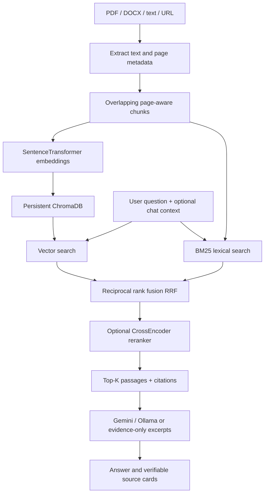

# DocuLens AI — Multi-document Hybrid RAG

**An executable research/document assistant with source-grounded answers, an integrated web dashboard, a FastAPI backend, configurable LLM generation, persistent retrieval, and evaluation.**

> This repository implements a Retrieval-Augmented Generation (RAG) **pipeline**, not a foundation model trained from scratch. Production mode uses pretrained embedding and reranking models and an external or local generative LLM. The optional `hash` embedding is only a deterministic offline test mode, not semantic search.

## Features

| Feature | Implementation |
| --- | --- |
| Upload documents | PDF, DOCX, TXT, Markdown, HTML, CSV, JSON |
| Paste content | Named raw text documents |
| Fetch public URL | HTML, PDF, plaintext, Markdown, CSV, JSON (SSRF checks) |
| PDF references | Text extracted and chunked separately for each actual PDF page |
| Embeddings | `sentence-transformers/all-MiniLM-L6-v2` by default |
| Vector store | ChromaDB persistence; simpler SQLite cosine store for local/offline use |
| Hybrid retrieval | BM25 with vector search, combined using reciprocal rank fusion (RRF) |
| Rerank | Optional `cross-encoder/ms-marco-MiniLM-L-6-v2` |
| Answer generation | Gemini (`google-genai`) or local Ollama; evidence-only fallback |
| Citations | `[1]`, `[2]`, etc. plus filenames, PDF page numbers, and source excerpts |
| Sessions | Chat history in SQLite; pronoun follow-up retrieval and context-aware generation |
| Prompt templates | Q&A, compare, summarize, extract, study, quiz, plus custom formatting instructions |
| Manage documents | List, select, download originals, remove files and indexed passages |
| Evaluate | Document Recall@K, mean reciprocal rank (MRR), query latency |
| API | FastAPI + OpenAPI docs at `/docs` |
| Security | Input limits; configurable access token; basic public-URL checks; source text explicitly marked untrusted |
| Deployment | Dockerfile, Compose, GitHub Actions test workflow |

## Quick start — Windows PowerShell

**One-click launcher (after initial setup):** On Windows, double-click `Start_DocuLens.bat` in the project root. It checks for a local Python environment, installs project dependencies if missing, starts the FastAPI server only if one is not already running, and opens `http://127.0.0.1:8000`. Server logs from launcher-managed starts are stored under `data/logs/`. If the Gemini key is blank, the app operates in cited evidence-only mode until you add the key privately to `.env`. **After changing `.env`, double-click `Restart_DocuLens.bat`**; it checks the program using port 8000 before stopping anything and relaunches DocuLens with the new settings. Never share or commit your API key.

**Requirements:** Python 3.11 or 3.12 recommended, pip, internet access for initial downloads, and enough disk space for pretrained models. Use a fresh virtual environment.

```powershell
cd doculens-ai
py -3.11 -m venv .venv
.\.venv\Scripts\Activate.ps1
python -m pip install --upgrade pip
pip install -r requirements.txt
Copy-Item .env.example .env
# Open .env in a text editor and insert your key if using Gemini.
uvicorn doculens.api:app --host 127.0.0.1 --port 8000
```

Open:

- **App:** http://127.0.0.1:8000
- **API docs:** http://127.0.0.1:8000/docs
- **Health:** http://127.0.0.1:8000/api/health

The browser dashboard is **included with FastAPI**; no Streamlit or separate frontend development server is required. The first ingest/search can take time because the embedding and reranking models download on first use.

### Linux/macOS

```bash
cd doculens-ai
python3.11 -m venv .venv
source .venv/bin/activate
python -m pip install --upgrade pip
pip install -r requirements.txt
cp .env.example .env
uvicorn doculens.api:app --host 127.0.0.1 --port 8000
```

### LLM configuration

Choose **one** in `.env`:

**A. Gemini (recommended for a laptop demo):**

```dotenv
LLM_PROVIDER=gemini
GEMINI_API_KEY=your_own_key_here
GEMINI_MODEL=gemini-3.5-flash-lite
```

The model ID is configurable; replace it with one available on your account if the provider changes availability. **Never commit `.env` or post keys in chat/repositories.**

**B. Ollama (no hosted LLM key):** install and run [Ollama](https://ollama.com), pull the model using `ollama pull llama3.2:3b`, then:

```dotenv
LLM_PROVIDER=ollama
OLLAMA_MODEL=llama3.2:3b
OLLAMA_URL=http://localhost:11434
```

For Ollama running on your **host** with Docker, change `OLLAMA_URL` to a host address reachable from the container (for example `http://host.docker.internal:11434`, if supported by your Docker setup).

**C. Evidence-only mode:**

```dotenv
LLM_PROVIDER=none
```

This returns real retrieved excerpts with citation numbers, not synthesized answers. If `LLM_PROVIDER=gemini` has no key, the app also switches to evidence-only responses; it doesn't claim to have generated an LLM answer.

### Diagnostic offline mode

When model repositories/API services are unavailable, use the test mode to verify document ingestion, vector storage, search, APIs and citations:

```powershell
Copy-Item .env.offline.example .env
uvicorn doculens.api:app --host 127.0.0.1 --port 8000
```

This uses `EMBEDDING_BACKEND=hash`, `VECTOR_BACKEND=sqlite`, `LLM_PROVIDER=none` and `ENABLE_RERANKER=false`. **Hash vectors are not an adequate substitute for a semantic embedding model; use normal mode for actual RAG quality.**

A no-server command-line demo is also included:

```bash
python -m scripts.demo_offline
```

## Find exact source content and keep the local app healthy

**Find content / passages:** Select the relevant PDFs in the sidebar, then choose **Find content / passages** (or just ask in Question & Answer mode, e.g., `find the passage about customer satisfaction`). DocuLens retrieves source passages, focuses each quote around the requested words, and returns the matching file and PDF page with clickable citations. It does not ask Gemini to paraphrase the selected text, so this mode works during LLM outages. If nothing qualifies, it reports no matching passage instead of returning unrelated filler. This is source-text retrieval, not the same as retraining an AI model.

**Automatic local health watch:** Windows Task Scheduler runs `Watch_DocuLens.ps1` through the **DocuLens AI Health Watch** task every 15 minutes while you're logged in. It checks local `/api/health` and performs one real, unbilled retrieval query against `paper_b.md` (skipped if you delete that demo source). If the server is down, it safely restarts only the verified DocuLens process using `Restart_DocuLens.ps1`; it will not terminate unrelated processes. On retrieval-quality failure it records `degraded` for review without automatically modifying or deleting uploaded documents, model files, or indexes.

- To review recent checks, double-click `Watch_Status.bat`. Detailed logs are in `data/logs/health-watch.jsonl` (rotated automatically, containing status and counts only, not document text or secrets).
- To re-enable or update the scheduled watch: `powershell -NoProfile -ExecutionPolicy Bypass -File .\\Install_DocuLens_Watch.ps1`
- To disable it: `powershell -NoProfile -ExecutionPolicy Bypass -File .\\Install_DocuLens_Watch.ps1 -Remove`
- To run a check now: `powershell -NoProfile -ExecutionPolicy Bypass -File .\\Watch_DocuLens.ps1`

The watch runs **only while the Windows user is signed in and the laptop is on**. It can restart the service and report quality issues, but it does not autonomously edit source code or deploy changes. Periodic health checks do not use a paid LLM API.

## Library-aware answers and document comparisons

DocuLens answers file inventory questions from PostgreSQL metadata instead of sending vague phrases to vector search. Examples:

- `What PPTs are in our sources?` — accurately reports when no PowerPoint is uploaded. Direct PPT/PPTX upload isn't supported; export slides to PDF first.
- `Which PDFs are in my sources?` / `list my uploaded files` — lists only the selected matching source files.
- `What do these documents have in common?` — combines one representative opening excerpt **from each selected document** (up to eight) and asks Gemini to identify overlaps, distinguish document-specific topics, and explain when no topic is shared across all. These are *document overviews*, not measured vector similarity scores, and are not exhaustive reads of long PDFs.
- `Find the word the in this` — performs exact case-insensitive word lookup, including stopwords, with per-page counts.

The chat sidebar includes All/None source selection and shortcut buttons for listing PDFs and finding common themes. If the model abstains, unrelated excerpts are not added as fake citation references. Use narrower questions and selected sources when full-length documents contain multiple topics.

## Conversational chatbot (document mode + general mode)

The chat composer has two distinct answer boundaries:

- **Question & answer / Study / Compare / Summarize:** Questions are grounded in selected documents. Attach a PDF directly in chat; that PDF becomes the active selected source for follow-up questions. Source references and original PDF page numbers appear where available. Ask `what is this pdf about?` for a summary-focused retrieval query.
- **General chat (no documents):** Use Gemini or Ollama as an ordinary conversational assistant, with session history, without claiming document citations. This mode works even if no documents are selected.
- **Exact word or phrase lookup:** Ask `find the word the in this` or `count the word theory`. This bypasses stop-word removal and returns exact counts by document/page, including ordinary words such as *the*. This is deterministic text search, not semantic similarity.

When Gemini has a temporary server error, the document mode tries a secondary lightweight model, then returns clearly labelled retrieved evidence rather than HTTP 500. General chat provides an availability explanation if both models are down. This is a retrieval/application improvement, **not fine-tuning or model retraining**. Scanned PDFs still require OCR support to be enabled separately.

## One-click verification on Windows

After starting DocuLens, double-click `Verify_DocuLens.bat` in the project root. This checks your local PostgreSQL connection, runs the Python automated test suite, and measures sample retrieval quality through the live API. The tool does not alter your PDFs or conversation history.

For a full browser integration audit, run `python -m scripts.browser_live_rag_check` from the project virtual environment. It uploads a temporary two-page synthetic PDF, checks an actual Gemini-generated answer and source citation, verifies chat persistence and CrossEncoder reranking, and then removes its own test records.

To inspect the database graphically, use pgAdmin 4 → DocuLens Local → Databases → doculens_rag → Query Tool. Only use SQL in pgAdmin, not PowerShell commands. For a terminal database summary, run `python -m scripts.db_inspect`.

The small sample-data evaluation uses fictional illustrative papers and is **not** an estimate of performance on real research articles.

## Local PostgreSQL integration (Windows)

The project supports a fully working **PostgreSQL metadata and conversation database** alongside **ChromaDB vector storage**. PostgreSQL manages `documents` (uploaded document IDs, names, types, page/chunk counts and file paths) and `messages` (chat history with session IDs); Chroma indexes embeddings and chunk text. Both stores share document IDs.

The local Windows setup uses an **isolated PostgreSQL 18 cluster on 127.0.0.1:5433** (not the existing system PostgreSQL service on port 5432). The login `doculens_app` owns the `doculens_rag` database but is not the cluster superuser. This is for local development; don't expose the port to the internet.

Run once inside the activated project virtual environment:

```powershell
python -m scripts.pg_local setup
```

This creates the database with randomly generated local credentials, migrates any existing SQLite document and chat records, retains a SQLite backup at `data/metadata.before-postgres.sqlite3`, and edits only `METADATA_BACKEND` and `DATABASE_URL` in your local `.env`. **Never commit or share `.env` or `data/private/postgres-admin.json`.**

To inspect the database without showing credentials:

```powershell
python -m scripts.pg_local status
python -m scripts.db_inspect
```

`Start_DocuLens.bat` and `Restart_DocuLens.bat` start the isolated PostgreSQL server when needed and run the API; the existing PostgreSQL Windows service is never modified. For pgAdmin, connect to host `127.0.0.1`, port `5433`, database `doculens_rag`, username `doculens_app`, using the password from the local `.env` connection URL.

**Gemini tip:** Use a model advertised to your API key, such as `gemini-3.5-flash-lite` (verified in the Windows setup). If the provider rejects a model or is unavailable, retrieval works independently and evidence-only mode remains available.

## Attach files directly in chat

On the **Ask your documents** screen, click **＋ Attach** next to the question box to choose a PDF/DOCX/TXT/Markdown/HTML/CSV/JSON file (up to 20 MB each; 10 files per message). You can also drag a file anywhere onto the chat screen, or paste a PDF/document if your browser supplies it as a clipboard file. **Ctrl+V of ordinary text remains normal text paste.** Some browsers and Windows Explorer clipboard formats do not expose copied PDF files through the browser clipboard API; in that case use Attach or drag-and-drop.

Files appear as removable chips. Press **Send** to index the files and immediately ask your question against the new attachments. You can send only a PDF with an empty message to get an automatic summarization request. New attachments remain in the Knowledge Library for follow-up questions and citations. Duplicate uploads are reused rather than creating another record. Server-side file type and size restrictions still apply. Uploaded documents are stored locally in the configured data directory.

## Try it

1. Open **Knowledge library**; upload `sample_data/paper_a.md` and `sample_data/paper_b.md` together.
2. Select both documents in the sidebar.
3. In **Ask your documents**, ask: **“Compare Paper A and Paper B: methods, numbers and limitations.”**
4. Switch the answer mode to **Compare**. Check citation excerpts and available original files.
5. In **RAG evaluation**, paste `evaluation/example_cases.json` and replace the document IDs with the ones shown by **Copy ID** in the library.

The example paper metrics are **fictional demonstration values**, explicitly marked in the files.

## Architecture



### Why these choices?

- **Chunking**: prevents full documents from exceeding LLM context windows; keep PDF pages separate for traceable evidence.
- **Embeddings**: map semantically similar text to nearby vectors even when wording differs.
- **BM25**: helps find exact names, codes, uncommon terms, and numeric phrases that dense retrieval can miss.
- **RRF**: merges two ranked lists without assuming their score scales are comparable (`1/(60+rank)` for each list).
- **CrossEncoder**: performs a slower query–passage joint scoring step only on shortlisted chunks, not the entire corpus.
- **Source grounding**: the model receives numbered untrusted excerpts and is instructed to cite valid evidence and abstain when information is missing. This mitigates, but **does not eliminate**, hallucinations.
- **SQLite metadata**: simple local document registry and session persistence. Chroma is used for scalable vector retrieval; SQLite cosine is a lightweight smaller-dataset alternative.

### How a user prompt is processed

1. The question and selected source IDs arrive through `/api/chat`.
2. If it is a short referential follow-up, the last user question is included in the **retrieval query** (not promoted to evidence).
3. Chroma vector search and BM25 each retrieve candidates.
4. RRF combines their rankings, then CrossEncoder reranks (when available and enabled).
5. Chunks become numbered `[SOURCE 1] ... [/SOURCE 1]` blocks containing original text and provenance.
6. The system prompt says source data is untrusted, documents are the only evidence, and unsupported claims must be omitted.
7. Gemini or Ollama returns a Markdown answer; the API returns ordered source evidence and rejects unknown numeric citation references.
8. The frontend displays answer citations and document excerpts; the conversation is stored in SQLite.

## REST API

| Method | Path | Purpose |
| --- | --- | --- |
| GET | `/api/health` | Status and backend settings (no secrets) |
| GET | `/api/documents` | List indexed sources |
| POST | `/api/documents/upload` | Multipart `file`, or raw file bytes with `X-Filename` |
| POST | `/api/documents/text` | `{ "title": "Notes", "content": "..." }` |
| POST | `/api/documents/url` | `{ "url": "https://..." }` |
| GET | `/api/documents/{id}/file` | Retrieve uploaded original |
| DELETE | `/api/documents/{id}` | Remove a source and its vectors |
| POST | `/api/search` | Retrieve top chunks without generating text |
| POST | `/api/chat` | Generate grounded response with citations |
| GET | `/api/sessions/{session_id}` | Read chat history |
| DELETE | `/api/sessions/{session_id}` | Clear conversation |
| GET | `/api/prompts` | List answer modes |
| POST | `/api/evaluate` | Evaluate retrieval against labeled questions |

Example payload:

```json
{
  "question": "What limitations do the papers identify?",
  "mode": "compare",
  "top_k": 5,
  "rerank": true,
  "source_ids": null,
  "custom_instructions": "Explain briefly using a comparison table."
}
```

`source_ids=null` searches all indexed documents. An explicit list restricts retrieval to those sources. Page numbers appear only for PDFs; non-PDF page layout cannot be guaranteed by the chosen parsers.

### Test with curl

```bash
curl -X POST http://127.0.0.1:8000/api/documents/text \
  -H 'Content-Type: application/json' \
  -d '{"title":"RAG note","content":"BM25 retrieves exact keyword matches. Embeddings retrieve semantic matches."}'

curl -X POST http://127.0.0.1:8000/api/chat \
  -H 'Content-Type: application/json' \
  -d '{"question":"How does BM25 differ from embeddings?","mode":"compare","rerank":false}'
```

If `APP_ACCESS_TOKEN` is set, include header `X-App-Token: YOUR_TOKEN` on API calls (the dashboard has a matching **Access** button).

## Testing

```bash
pip install -r requirements-dev.txt
python -m pytest -q
python -m scripts.demo_offline
```

Automated tests use offline hash embeddings + SQLite and cover ingestion, PDF page metadata, filtering, deduplication, source citations, API routes, deletion, chat sessions, and Recall@K/MRR. **They do not test live Gemini, Chroma, transformer model weights, scanned OCR, or Docker startup without those dependencies/services installed.** Those integration checks should be performed in your target environment before claiming production readiness.

The default test backend is independent of Google credentials and model download availability; when you run the full application with the normal backend, models are downloaded at first use.

## Docker deployment

```bash
cp .env.example .env
# Set GEMINI_API_KEY or select Ollama/none and APP_ACCESS_TOKEN.
docker compose up --build
```

The Compose file maps the service to `127.0.0.1:8000`, so it is **not exposed publicly** by default. `./data` is persisted. Use your own auth/reverse-proxy/TLS configuration and security review before putting this online.

## Scanned PDFs / optional OCR

For scanned image PDFs, install `pip install -r requirements-ocr.txt`, install the **Tesseract** executable on your OS, and set `ENABLE_OCR=true`. OCR runs on pages without selectable text. OCR quality depends on language and scan quality; there is no table/diagram/image understanding in this version.

## Limitations and responsible use

- A RAG application is not guaranteed to be correct. Check cited excerpts, especially for health, legal, financial or scientific conclusions.
- Website import offers basic DNS/private-address and redirect checks; it is **not a hardened web-fetching gateway**. For public deployment, disable or isolate remote fetch behind authenticated infrastructure, egress restrictions, redirect/DNS pinning and request limits.
- The workspace is a **single-user/local prototype**, not a secure multi-tenant SaaS. It does not isolate documents by user, enforce quotas, provide full audit logging or per-document permissions.
- PDF text extraction is primarily selectable text, and complicated layouts, scanned pages, formulas and tables may require more sophisticated parsing/OCR.
- Reranker loading and PDF ingestion can be CPU-intensive; for large datasets, add background ingestion jobs, pagination and cached BM25 indexes.
- The current evaluator measures retrieval, not LLM faithfulness, groundedness, factual correctness, answer similarity, or prompt injection resistance. Use a separately validated evaluation set for credible resume metrics.
- Changing the embedding model can change vector dimensions. **Reindex your documents in a fresh `DATA_DIR`** rather than mixing incompatible embeddings.

## Repository guide

```text
doculens-ai/
├── doculens/
│   ├── api.py            # HTTP API, security, file upload, static dashboard
│   ├── service.py        # Document ingestion, querying, chat, evaluation
│   ├── ingestion.py      # PDF, DOCX, text, HTML, CSV, JSON, URL parser
│   ├── chunking.py       # Page-preserving overlapping chunks
│   ├── embeddings.py     # SentenceTransformer, deterministic diagnostic embedder
│   ├── vectorstore.py    # Chroma, SQLite and in-memory stores
│   ├── retrieval.py      # BM25, vector retrieval, RRF, reranking
│   ├── llm.py            # System prompt, templates, Gemini, Ollama
│   ├── database.py       # SQLite document registry and sessions
│   └── settings.py       # Configuration
├── frontend/             # Standalone HTML + CSS + JS dashboard
├── tests/                # Offline automated ingestion and API tests
├── sample_data/          # Two demonstrative papers (fictional metrics)
├── evaluation/           # Labeled evaluation JSON template
├── scripts/              # Offline CLI smoke demo
├── .env.example
├── .env.offline.example
├── Dockerfile
├── compose.yaml
└── requirements.txt
```

## Next production milestones

The repository implements the complete local demo pipeline. Meaningful upgrades for a hosted, multi-user service would be asynchronous worker queues, user-based vector filtering and auth, secret management, rate limiting, hardened URL-fetching, stronger document parsers, comprehensive retrieval/answer evaluation, logging, and observability. Do not describe these as already implemented.
